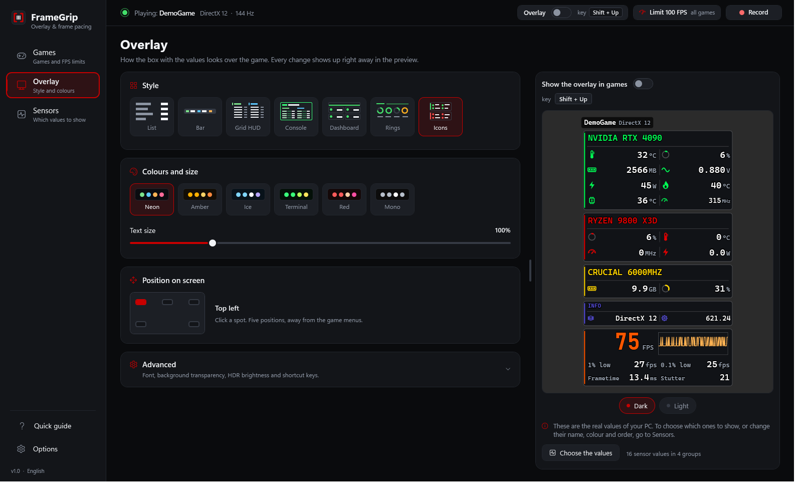
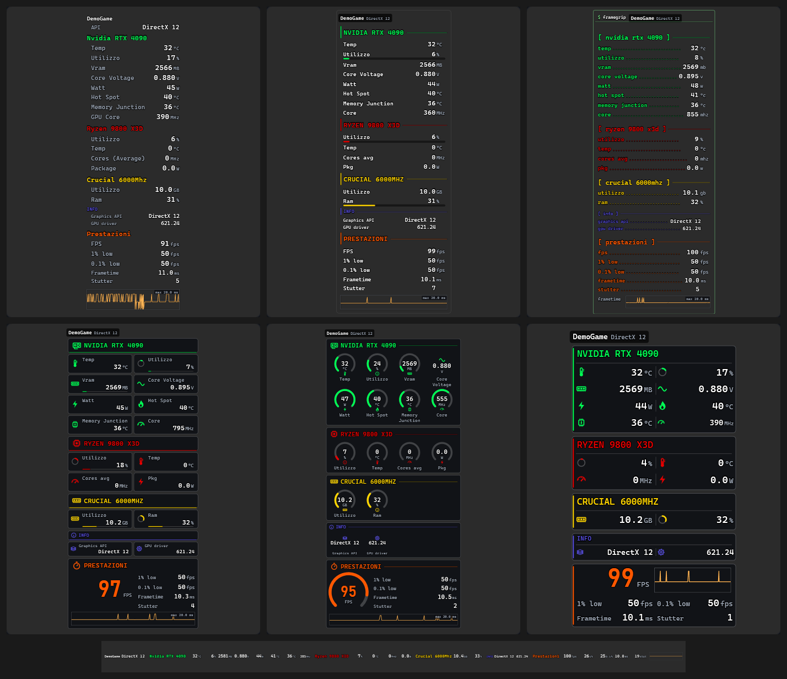
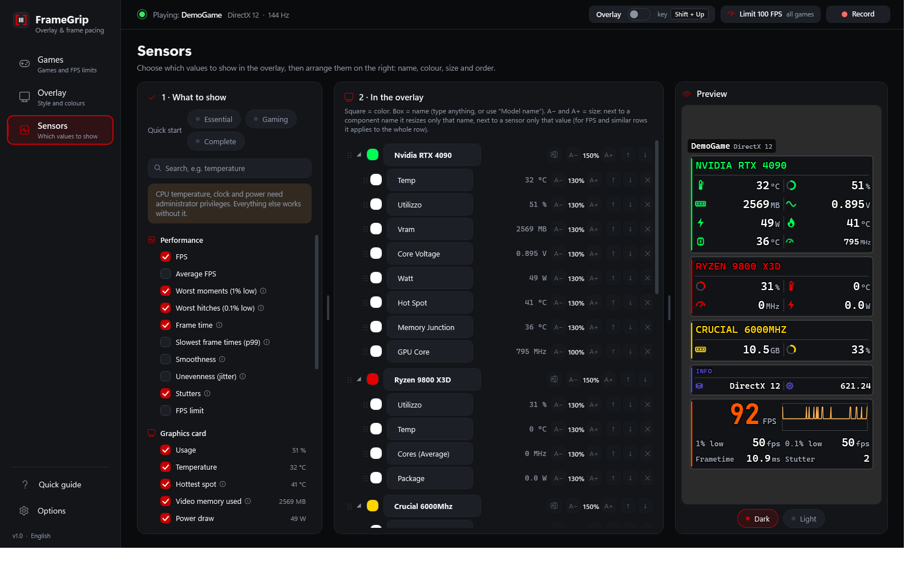
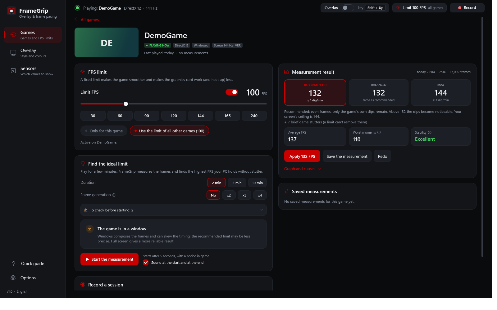
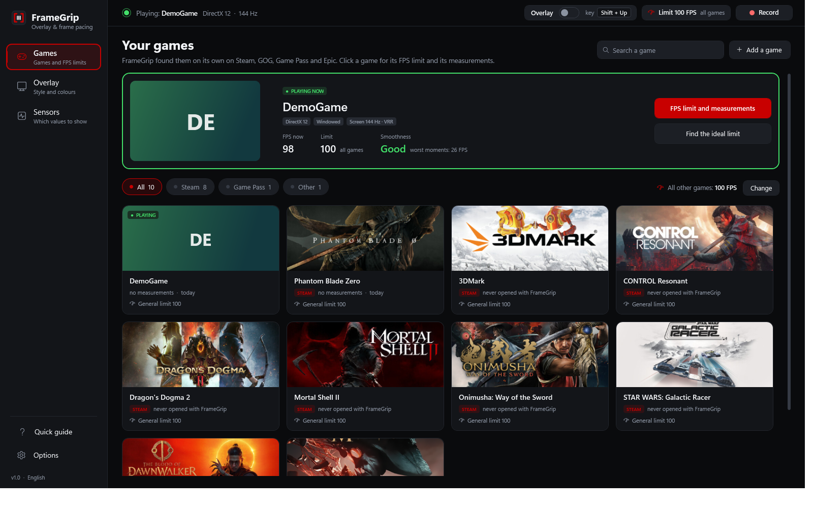
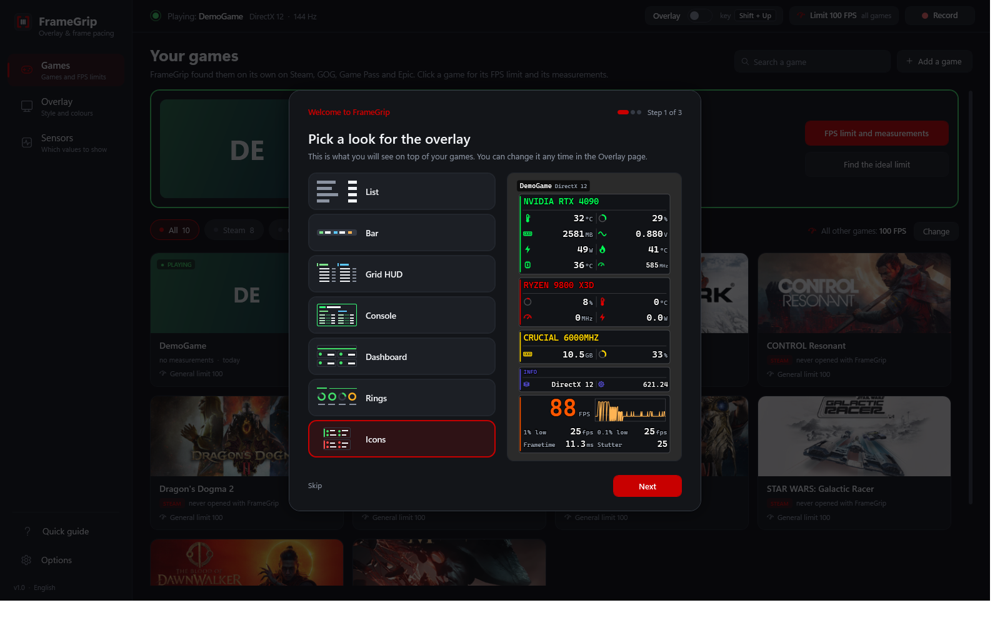

  

<h1 align="center">FrameGrip</h1>

  <b>In-game overlay and FPS limiter for Windows: free, open source, simple.</b> 
  FPS, frametime, 1% / 0.1% lows and hardware sensors on top of your game, plus a smart per-game frame cap.

  
  
  

  

---

## What it does

- **In-game overlay**: FPS, frametime graph, 1% and 0.1% lows, stutter count, and GPU / CPU / RAM sensors (temperature, clock, load, power, VRAM, voltage and more).
- **7 overlay styles**: List, Bar, Grid HUD, Console, Dashboard, Rings and Icons. Each one comes in 6 colour themes, with text size, background opacity and screen position you can adjust.
- **Your sensors, your order**: pick exactly which values to show, then rename, recolour, resize and reorder them with drag and drop. A live preview shows every change instantly.
- **FPS limiter**: a global cap, or a separate cap for each game.
- **Ideal limit**: play for a few minutes and FrameGrip measures your game and suggests the highest cap it can hold steadily. It offers three options: *Recommended*, *Balanced* and *Max*. It takes your refresh rate, G-Sync / FreeSync and frame generation into account.
- **Automatic game library**: finds your Steam, Game Pass, GOG and Epic games on its own. You can also add any other game by hand.
- **Recording**: start and stop a frametime recording with a hotkey, right from inside the game.
- **Remappable hotkeys** for the overlay, recording and ideal-limit measurement.
- **Borderless warning**: tells you when a game runs in a window, which can hurt frame pacing.
- **English and Italian** interface, with light and dark themes.

## Overlay styles

  

## Screenshots

| Sensors | Ideal limit |
|---|---|
|  |  |
| **Game library** | **First start** |
|  |  |

## Supported games

| Graphics API | Overlay | FPS limiter |
|---|:---:|:---:|
| Direct3D 12 | ✅ | ✅ |
| Direct3D 11 | ✅ | ✅ |
| Direct3D 9 / 9Ex | ✅ | ✅ |
| Vulkan | ✅ | ✅ |
| OpenGL | ✅ | ✅ |
| Direct3D 10 | ❌ | ✅ |
| DirectX 8 and older | ❌ | ❌ |

- Works with both 64-bit and 32-bit games.
- FPS and frametime are measured with Windows ETW events, so the numbers are correct for every API.
- Vulkan support uses an official Vulkan layer, which is registered only while FrameGrip is running. You can turn it off with `DISABLE_FRAMEGRIP_VK_LAYER=1`.

## What it does not do

- **It is not made for online games with anti-cheat.** FrameGrip draws its overlay by loading a small module into the game. Anti-cheat systems such as Easy Anti-Cheat, BattlEye, Vanguard and Ricochet may block it or flag it. **In online multiplayer games, use it at your own risk**, or keep it off for those games.
- No overlay in Direct3D 10 games (the limiter still works there).
- It cannot reliably detect G-Sync / FreeSync, or the frame generation multiplier (×2 / ×3 / ×4). You set them once: G-Sync in *Options → Display*, frame generation per game.
- It does not change your game files, drivers or graphics settings.
- It does not collect or send any data. There is no account, no telemetry and no ads.

## Requirements

- Windows 10 or 11, 64-bit.
- **Administrator rights**: Windows requires them to read frame timing (ETW) and to show the overlay in games that run as administrator. During setup, the installer creates a scheduled task so FrameGrip starts without asking for confirmation every time.
- Nothing else to install: .NET is included.
- *Optional:* CPU temperature, clock and power need the free **PawnIO** driver. FrameGrip offers to install it only if you ask.

## Install

1. Download `FrameGrip-Setup-1.0.0.exe` from [Releases](https://github.com/Ourze80/FrameGrip/releases/latest).
2. Run it and follow the steps.
3. Open FrameGrip, choose an overlay style, and start a game: FrameGrip recognises it on its own.

> The installer is not code-signed yet, so Windows SmartScreen may show a warning. Click **More info → Run anyway**. Some antivirus programs can flag the small injector (`ffinject64.exe`) by mistake, because many overlay tools work the same way. The full source code is here, so you can check it or build it yourself.

To update, close FrameGrip and the game, then install the new version over the old one. Your settings are kept.

## Default hotkeys

| Action | Keys |
|---|---|
| Show / hide overlay | `Ctrl + Shift + O` |
| Start / stop recording | `Ctrl + Shift + B` |
| Measure the ideal limit | `Ctrl + Shift + M` |

You can change all of them in *Options → Hotkeys*.

## Build from source

See [CONTRIBUTING.md](CONTRIBUTING.md). In short: you need Visual Studio 2022 Build Tools (C++), the .NET 8 SDK and Inno Setup 6.

## Support the project ❤️

FrameGrip is free and always will be. If you find it useful, a donation helps me keep working on it **and** on my other free app:

- **[HDLSS5](https://github.com/Ourze80/Ourze)**: a graphics mod manager for NVIDIA RTX GPUs (DLSS, ReShade, RenoDX, OptiScaler, HDR). Every change it makes can be undone.

  

A single donation supports both FrameGrip and HDLSS5. Thank you!

## License

FrameGrip is released under the [GNU General Public License v3.0](LICENSE).

It uses these third-party components:

| Component | Licence |
|---|---|
| [MinHook](https://github.com/TsudaKageyu/minhook) | BSD-2-Clause |
| [Vulkan-Headers](https://github.com/KhronosGroup/Vulkan-Headers) | Apache-2.0 / MIT |
| [LibreHardwareMonitorLib](https://github.com/LibreHardwareMonitor/LibreHardwareMonitor) | MPL-2.0 |
| [Microsoft.Diagnostics.Tracing.TraceEvent](https://github.com/microsoft/perfview) | MIT |
